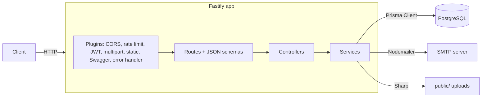
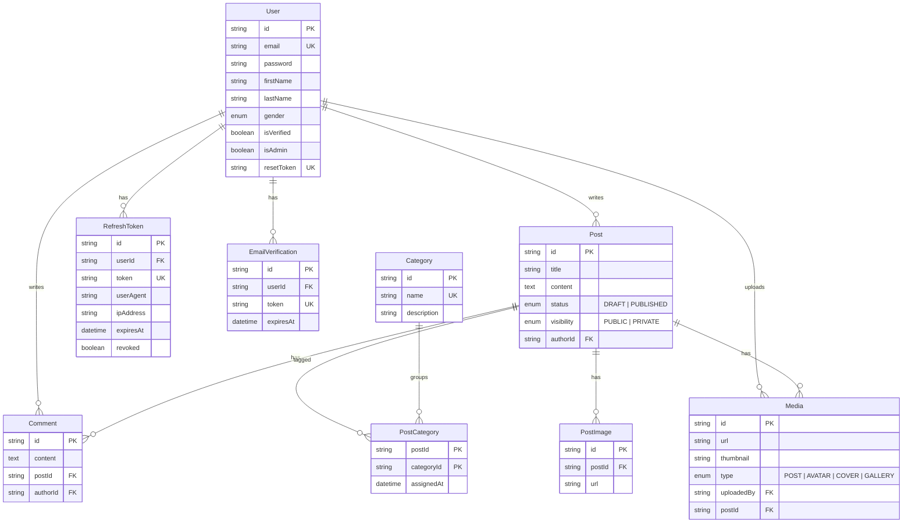

# Personal Blog API

REST API backend for a personal blogging platform: user accounts with email verification, JWT access and refresh tokens, a draft-to-publish post workflow, categories, comments, and image uploads. Built with Fastify 5, TypeScript, Prisma and PostgreSQL.


## Overview

The API covers the backend side of a blog: people register and verify their email, log in to get a short-lived access token plus a stored refresh token, write posts that start as empty drafts and are published once they have a title and content, attach images, and comment on each other's posts. Admins manage the category list. Request and response shapes are defined once with Zod, converted to JSON Schema, and used both for Fastify validation and for the generated Swagger documentation.

## Key features

- **Registration and email verification** — bcrypt password hashing, verification token stored in `EmailVerification` with a 24-hour expiry, verification email via Nodemailer (`src/modules/auth`, `src/utils/email.ts`).
- **JWT authentication** — access and refresh tokens signed with `@fastify/jwt`; refresh tokens are persisted per user agent and IP, can be revoked, and are revoked on password change (`src/utils/token.ts`, `src/modules/user/user.service.ts`).
- **Password reset** — time-limited reset token stored on the user record (`/api/auth/forgot-password`, `/api/auth/reset-password`).
- **Role check** — `authenticate` and `authenticateAdmin` decorators; category writes are admin-only (`src/plugins/jwt.ts`).
- **Posts** — create an empty draft, then update title, content, status (`DRAFT`/`PUBLISHED`), visibility (`PUBLIC`/`PRIVATE`) and categories; only the author can update or delete (`src/modules/post`).
- **Search and filtering** — case-insensitive search on title and content, filters by category, author and creation date range, with pagination (`PostService.getAll`).
- **Comments** — create, edit and delete your own comments; paginated listing per post and per user (`src/modules/comment`).
- **Image uploads** — multipart upload (PNG/JPEG, 10 MB limit) saved under `public/`, with a 300 px JPEG thumbnail generated by Sharp for post images; served by `@fastify/static` (`src/utils/file.ts`).
- **Rate limiting** — `@fastify/rate-limit`, default 100 requests per minute per token or IP (`src/plugins/rate-limit.ts`).
- **Consistent responses** — `reply.success()` / `reply.error()` decorators and a global error handler for `AppError` (`src/plugins/replyDecorator.ts`, `src/plugins/errorHandler.ts`).
- **API docs** — OpenAPI 3 spec and Swagger UI generated from the route schemas (`src/plugins/swagger.ts`).

## Tech stack

| Layer | Technology |
| --- | --- |
| Runtime | Node.js, TypeScript 4.9 (run with `ts-node-dev`) |
| Web framework | Fastify 5.2 with `@fastify/jwt`, `@fastify/cors`, `@fastify/rate-limit`, `@fastify/multipart`, `@fastify/static`, `@fastify/swagger` |
| Validation | Zod 3 + `zod-to-json-schema` |
| Database | PostgreSQL 15, Prisma ORM 6.5 |
| Auth | JWT, bcrypt |
| Email | Nodemailer (SMTP) |
| Images | Sharp |
| Logging | Pino + pino-pretty |
| Tooling | pnpm, ESLint, Prettier, Husky, lint-staged, commitlint |
| Containers | Dockerfile, docker-compose (PostgreSQL + API) |

## Architecture

Each feature lives in its own module with a `route → controller → service` split. Routes declare the JSON schemas and auth hooks, controllers translate the request into service calls, and services hold the business rules and talk to Prisma. Cross-cutting concerns are Fastify plugins registered once at startup.



### Data model

Derived from `prisma/schema.prisma`. `ERD.md` contains an earlier planning draft (roles and permissions) that was not implemented; the diagram below reflects the current schema.



## Project structure

```text
.
├── prisma/
│   ├── schema.prisma        # Data model
│   └── migrations/          # SQL migrations
├── src/
│   ├── app.ts               # Builds the Fastify instance (CORS, plugins, routes)
│   ├── server.ts            # Entry point, listens on port 3000
│   ├── config/              # env defaults, logger, Swagger, AWS client
│   ├── plugins/             # database, jwt, rate-limit, multipart, static, swagger, error handler, reply helpers
│   ├── modules/             # auth, user, post, category, comment, media (route/controller/service)
│   ├── schema/              # Zod schemas and their JSON Schema exports
│   ├── middlewares/         # Standalone auth helpers
│   ├── cron/                # Expired refresh-token cleanup job (not yet scheduled)
│   ├── seed/seedAdmin.ts    # Creates a local admin user
│   └── utils/               # email, token, file upload, AppError
├── types/                   # Fastify and @fastify/jwt type augmentation
├── docker-compose.yml       # PostgreSQL + API
└── dockerfile
```

## Getting started

### Prerequisites

- Node.js 20 or later (Fastify 5 targets Node 20+)
- pnpm (the repo uses `pnpm-lock.yaml`)
- PostgreSQL 15, or Docker to run it from `docker-compose.yml`
- SMTP credentials if you want verification and reset emails to be delivered

### Install and configure

```bash
pnpm install
cp .env.example .env    # then fill in the values
```

### Start the database

Run only the database service from the compose file (exposed on host port `5434`):

```bash
docker compose up -d database
```

Make sure `DATABASE_URL` in `.env` points to `localhost:5434`.

### Apply migrations and generate the client

```bash
pnpm exec prisma migrate deploy
pnpm exec prisma generate
```

### Seed an admin user (optional)

```bash
pnpm exec ts-node src/seed/seedAdmin.ts
```

This creates an admin account using the email and password hard-coded in `src/seed/seedAdmin.ts`. Change them before using the seed anywhere other than a local machine.

### Run

```bash
pnpm dev
```

The API listens on `http://localhost:3000`.

- Swagger UI: `http://localhost:3000/docs`
- OpenAPI JSON: `http://localhost:3000/docs/json`

Other scripts: `pnpm lint`, `pnpm format`, `pnpm prettier:check`.

## Environment variables

Values are read in `src/config/env.ts`. `JWT_SECRET` has no default — the server refuses to start without it. Copy `.env.example` and fill in every value you need.

| Name | Required | Description |
| --- | --- | --- |
| `DATABASE_URL` | Yes | PostgreSQL connection string used by Prisma |
| `JWT_SECRET` | Yes | Secret used to sign access and refresh tokens |
| `ACCESS_TOKEN_EXPIRY` | No | Access token lifetime (default `2h`) |
| `REFRESH_TOKEN_EXPIRY` | No | Refresh token JWT lifetime (default `7d`) |
| `RATE_LIMIT_MAX` | No | Requests per minute per client (default `100`) |
| `SMTP_HOST` / `SMTP_PORT` | Yes, for email | SMTP server for verification and reset emails |
| `SMTP_USER` / `SMTP_PASS` | Yes, for email | SMTP credentials |
| `EMAIL_FROM` | Yes, for email | Sender address |
| `FRONTEND_URL` | No | Base URL used in the verification link |
| `BASE_URL` | No | Public base URL prepended to uploaded file URLs |
| `POSTGRES_USER` / `POSTGRES_PASSWORD` / `POSTGRES_DB` | For Docker | Read by the `postgres:15` container |
| `AWS_REGION` / `AWS_ACCESS_KEY_ID` / `AWS_SECRET_ACCESS_KEY` / `S3_BUCKET_NAME` | No | S3 client configuration; not used by the current upload flow |
| `NODE_ENV` | No | `production` lowers the log level to `info` |

`PORT` is read in `env.ts`, but `src/server.ts` currently listens on port `3000` directly.

## API reference

All routes are prefixed with `/api`. "JWT" means `Authorization: Bearer <access token>`.

### Auth — `/api/auth`

| Method | Path | Auth | Description |
| --- | --- | --- | --- |
| POST | `/register` | Public | Create an account and send a verification email |
| GET | `/verify-email?token=` | Public | Mark the account as verified |
| POST | `/login` | Public | Return access token, refresh token and user info (email must be verified) |
| POST | `/forgot-password` | Public | Create a reset token and email it |
| POST | `/reset-password` | Public | Set a new password using the reset token |
| POST | `/refresh-token` | Public (refresh token in body) | Issue a new access token |
| POST | `/resend-verification` | Public | Send a new verification email |

### User — `/api/user`

| Method | Path | Auth | Description |
| --- | --- | --- | --- |
| GET | `/profile` | JWT | Current user's profile |
| PUT | `/profile` | JWT | Update name, date of birth, gender, address, avatar URL |
| POST | `/change-password` | JWT | Change password and revoke all refresh tokens |
| POST | `/avatar` | JWT | Upload an avatar image (multipart) |

### Posts — `/api/post`

| Method | Path | Auth | Description |
| --- | --- | --- | --- |
| POST | `/draft` | JWT | Create an empty draft owned by the current user |
| PUT | `/:id` | JWT (author) | Update title, content, status, visibility and categories; publishing requires title and content |
| GET | `/:id` | JWT | Get a post by ID |
| GET | `/` | Public | List published public posts; supports `query`, `categoryId`, `authorId`, `createdFrom`, `createdTo`, `page`, `limit` |
| GET | `/user/me` | JWT | Current user's posts, paginated |
| DELETE | `/:id` | JWT (author) | Delete a post |

### Categories — `/api/category`

| Method | Path | Auth | Description |
| --- | --- | --- | --- |
| GET | `/` | Public | List categories |
| GET | `/:id` | Public | Get a category |
| POST | `/` | Admin | Create a category |
| PUT | `/:id` | Admin | Update a category |
| DELETE | `/:id` | Admin | Delete a category (rejected if posts use it) |

### Comments — `/api/comment`

| Method | Path | Auth | Description |
| --- | --- | --- | --- |
| POST | `/` | JWT | Comment on a post |
| PUT | `/:id` | JWT (author) | Edit a comment |
| DELETE | `/:id` | JWT (author) | Delete a comment |
| GET | `/post/:postId` | Public | Comments for a post, paginated |
| GET | `/user/me` | JWT | Current user's comments, paginated |

### Media — `/api/media`

| Method | Path | Auth | Description |
| --- | --- | --- | --- |
| POST | `/upload?postId=` | JWT (post author) | Upload a post image (PNG/JPEG, max 10 MB) and create a thumbnail |
| DELETE | `/:id` | JWT (uploader) | Delete a media record |

### Other

| Method | Path | Auth | Description |
| --- | --- | --- | --- |
| GET | `/docs` | Public | Swagger UI |
| GET | `/public/*` | Public | Uploaded files |

## Deployment

`dockerfile` builds a Node image with pnpm, runs `prisma generate`, and on start runs `prisma migrate deploy` followed by `pnpm run dev`. `docker-compose.yml` defines a `postgres:15` database (host port `5434`) and the API (host port `8080` → container `3000`), both reading `.env`. There is no hosted deployment.

## Known limitations

- `/register` and `/forgot-password` return the verification and reset tokens in the response body, which is convenient for local testing but must be removed before any real deployment.
- Refresh and access tokens share one secret, and the refresh-token type check is commented out.
- `GET /api/post/:id` does not yet check visibility, so any signed-in user can read another user's private draft by ID.
- Uploads are stored on local disk; the S3 client in `src/config/aws.ts` is not wired in yet.
- The expired-refresh-token cron job (`src/cron/cleanExpiredTokens.ts`) is written but not scheduled.
- `docker-compose.yml` waits for `service_healthy` on the database, but the database service has no healthcheck, so add one before using `docker compose up` for both services. The Dockerfile also uses `node:18`, while Fastify 5 targets Node 20+.
- There are no automated tests and no production build/start script; the app runs through `ts-node-dev`.

## Author

**Lê Văn Trung Tính** — Software Engineer | AI Product Builder

- Website: [trungtinh.site](https://trungtinh.site)
- GitHub: [@tinhne](https://github.com/tinhne)
